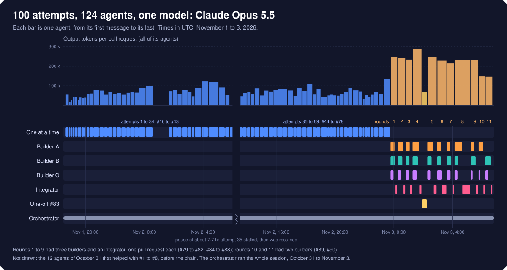

# How this project got here

This repo holds 20 small Java programs written more than ten years ago, recovered from what was left of them, fixed up, and then reworked into a browser arcade. This page tells that story in order. The per-app READMEs, [`web/README.md`](web/README.md) and the [pull requests](https://github.com/Nate314/old-java-applications/pulls?q=is%3Apr) have the details.

The source of inspiration for this project is the YouTube video [I Told Claude to "Make it better" 100 Times (It Went Too Far)](https://www.youtube.com/watch?v=DByAR5Su1Yw) by Nate Herk | AI Automation.

## The originals (2016 and earlier)

The apps were written by the author of this repo more than ten years ago, in high school, while the author was learning programming concepts with Java. They are Java Swing and AWT desktop programs: games (Minesweeper, Flappy Bird, Ultimate Tic-Tac-Toe, a tank game, a 2D Rubik's Cube), toys (a screen saver, floating stars, circles built out of windows, a fake desktop called NathaNOS), music tools (a synthesizer keyboard, a music theory helper) and small utilities (a clock, a stock checker, a group maker, a Bible downloader, a number guessing game, a set of algorithms, and two programs that press keys on Windows).

Fourteen of them were published as jars and zips on the author's site, https://nathangawith.com/applications/java, and are kept in the git history of its repo, https://github.com/Nate314/site, under `assets/javaApplications/`. Dated evidence that survives:

- The files inside those 14 jars and zips carry timestamps from April 28 to May 16, 2016 (ScreenSaver's are the oldest, the rest are from May 14 to 16, 2016).
- `StockChecker/stockCheck.csv`, saved by StockChecker itself, holds quotes dated May 13, 2016.

The other six apps (BibleDownloader, GroupCreator, MusicTheoryExpert, NumberGuess, SimpleAlgorithms, TankGame) came from the author's own files. No dates for those are recorded in this repo.

## The recovery (October 2026)

The source code was gone for most of the apps, so it was rebuilt from the compiled programs:

- **The first eight** (Clock, FlappyBird, Minesweeper, NathaNOS, RubiksCube2D, ScreenSaver, SpriteFloatyStars, UltimateTicTacToe) were downloaded from https://nathangawith.com/applications/java and decompiled with Vineflower 1.10.1 (the repo's first commit).
- **Six more** (CircleSpawner, DinoGame, StockChecker, SynthesizerKeyboard, Windows, WindowsE) were no longer on the site. They were found in the git history of the site repo and decompiled the same way ([#2](https://github.com/Nate314/old-java-applications/pull/2)).
- **The last six** came from the author's own files ([#8](https://github.com/Nate314/old-java-applications/pull/8)). MusicTheoryExpert, NumberGuess, SimpleAlgorithms and TankGame were the original Eclipse source; BibleDownloader and GroupCreator were jars, decompiled with Vineflower.

Most of the jars had been obfuscated, so classes were called `a`, `b`, `c` and locals `var1`, `var2`. Every one of those names was replaced with a descriptive English name, without changing any logic ([#1](https://github.com/Nate314/old-java-applications/pull/1), [#3](https://github.com/Nate314/old-java-applications/pull/3)). A few files needed hand fixes to compile again, listed in the root [README](README.md#notes).

## The first restoration

The next pull requests were each asked for directly, one at a time:

- **[#4](https://github.com/Nate314/old-java-applications/pull/4)** wrote a README for every app (what it does, its controls, its code layout and its known quirks) and `run.ps1`, which builds and runs any app from the repo root.
- **[#6](https://github.com/Nate314/old-java-applications/pull/6)** modernized all 20 apps: it fixed the bugs each README listed (Minesweeper's mine count and flood fill, Ultimate Tic-Tac-Toe's winner check, SimpleAlgorithms' sine, NumberGuess's range, and many more), moved timing work off the Swing event thread and added a few small features per app, keeping each app recognizably itself.
- **[#7](https://github.com/Nate314/old-java-applications/pull/7)** compiled 16 of the 20 apps to JavaScript with TeaVM, on a hand-written AWT/Swing/MIDI compatibility layer, so they run in a browser. DinoGame, Windows and WindowsE drove the real operating system and BibleDownloader read pages a browser could not fetch, so those four stayed desktop only.
- **[#9](https://github.com/Nate314/old-java-applications/pull/9)** replaced real people's names in GroupCreator's example with generic ones, made Modern the default web skin, and put every app on NathaNOS's taskbar.

That state, commit `5a28e46` on master, is what the site's **Then** versions play today (see [Then and now](web/README.md#then-and-now)): the recovered code with light bug fixes, before the reworks below.

## The Claude Code chain (from #10)

From [#10](https://github.com/Nate314/old-java-applications/pull/10) on, the pull requests were made by a chain of Claude Code subagents. Each one got the same task, to look at the project and make one bold change that improves the experience, and each pull request is stacked on the one before. At first the attempts ran one at a time; from [#79](https://github.com/Nate314/old-java-applications/pull/79) they ran in parallel rounds of three (a game or toy app, a tool or music app, and the site itself), merged and checked by an integrator into one pull request per round. [`prompt.md`](prompt.md) has the exact prompt and the rules the chain learned along the way.

Roughly, the work went through three phases:

1. **The site around the apps** (#10 to #21): a home page with a live player and thumbnail gallery, an arcade passport, a touch controller, the Arcade skin, an installable offline app, sounds, title screens, a source viewer, share cards and a real desktop for NathaNOS.
2. **The apps themselves** (#22 to #43): every app got a deeper pass of its own, for example Minesweeper levels and best times (#22), a computer opponent for Ultimate Tic-Tac-Toe (#23), a finished tank duel (#24), StockChecker as a practice trading desk (#39) and BibleDownloader as a Bible reader (#40). By #42 all 20 apps ran in the browser, including the ones that press keys, on a pretend Windows.
3. **Across apps and the whole site** (#44 on): the Then and now switch (#44), game controllers (#47), keyboard and screen reader support (#48), instant replay (#55), the computer playing the games (#58), a site screen saver (#64), live previews in the gallery (#70) and site-wide Find (#80), alongside further app work such as RubiksCube2D in 3D with a coach (#59, #78) and SimpleAlgorithms' sorting race and path finding (#65, #80).

The [pull request list](https://github.com/Nate314/old-java-applications/pulls?q=is%3Apr) has every change, each with what it did and how it was tested, and the home page's What's new section lists the changes app by app.

## The run in numbers

The 100 attempts are pull requests #10 to #78 (attempts 1 to 69, one at a time) and #79 to #90 (attempts 70 to 100, in eleven parallel rounds), with the one-off #83 between rounds 4 and 5. A final pull request on top of #90 adds this section, the jar downloads and the original art below, and carries all of it to master.

- **Model**: every agent, and the orchestrator session that started them and read their reports, ran on Claude Opus 5.5 (model id `claude-opus-5-5`) in Claude Code.
- **Agents**: 124 finished agents, all of whose usage was found: 69 one-at-a-time attempts, 31 round builders, 11 round integrators, the one-off #83, and 12 agents on October 31 that helped with #1 to #8 before the chain. The agent making this final pull request is not counted (it was still running when the numbers were read).
- **Tokens of the 124 agents**, summed over every model response in their transcripts: 7,769,877 output tokens; 21,752 input tokens not served from the prompt cache; 32,985,276 tokens written to the prompt cache; 1,510,951,972 tokens read from the prompt cache. That is 1,551,728,877 in all, almost all of it the same context read again from the cache on each turn. The 111 agents of the 100 attempts alone account for 6,978,117 output tokens and 1,353,738,248 in all.
- **The orchestrator's own tokens**, counted the same way from its session (October 31 to November 3, up to the start of the final pull request), are not in the numbers above: 522,249 output tokens; 1,684 uncached input tokens; 1,838,268 written to and 179,600,754 read from the prompt cache; 181,962,955 in all. With them the whole session comes to 8,292,126 output tokens and 1,733,691,832 tokens in all.
- **Tool calls**: 15,299 by the 124 agents, as reported when each finished.
- **Time**: the chain ran from November 1, 2026 at 18:39 UTC to November 3 at 06:42 UTC, about 36 hours, including a pause of about 7.7 hours when attempt 35's agent stalled and was resumed. The agents' own working time adds up to about 42 hours, about 8 of which is that stalled agent's wait.

These are the usage numbers Claude Code recorded for the session, not a bill: cache reads cost far less than fresh input, and the completion notices' own per-agent token figure (which counts differently) is not used here.

## Original art

Some of the pictures the apps loaded were not their own. FlappyBird's bird, pipes, sky and ground were the original Flappy Bird game's art, and BibleDownloader's icon was the YouVersion Bible App's icon. NathaNOS's desktop icons included Chrome's dinosaur (for DinoGame), a Windows Minesweeper mine and an unused Windows logo; its mouse pointer was a pointing hand from an icon set; and its other icons (Clock, NumberGuess, StockChecker, SynthesizerKeyboard, UltimateTicTacToe, plus unused calculator, converter and ping pong pictures) were clip art of unknown origin. Dino Game's pixel dinosaur and bird, drawn in its code, were modeled closely on Chrome's.

The final pull request replaced them with original art drawn for this repo: SVG files in each app's `art/` folder, rendered by `web/art.ps1` with headless Chrome to the PNG and JPEG files the Java code reads (same names, so the code did not change), and a new pixel dinosaur and bird in Dino Game's code. The unused pictures were removed. The Then versions, on the site and in the desktop launcher, show the new art too. Kept as they were, since nothing ties them to another app: NathaNOS's own logos, its wallpaper photo (where it came from is not recorded) and RubiksCube2D's plain cube net. The old files are still in the repo's git history, which was not rewritten.
