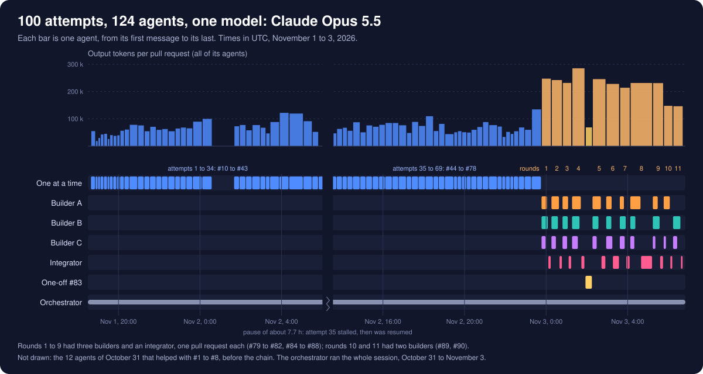
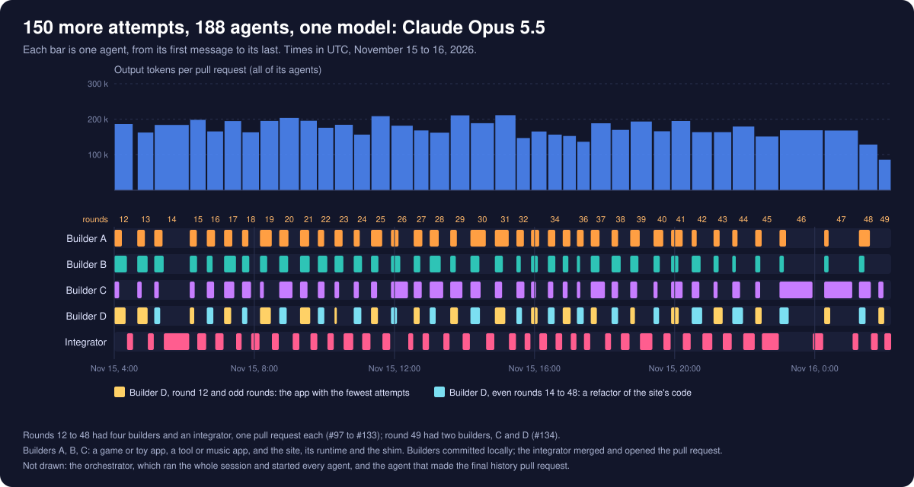
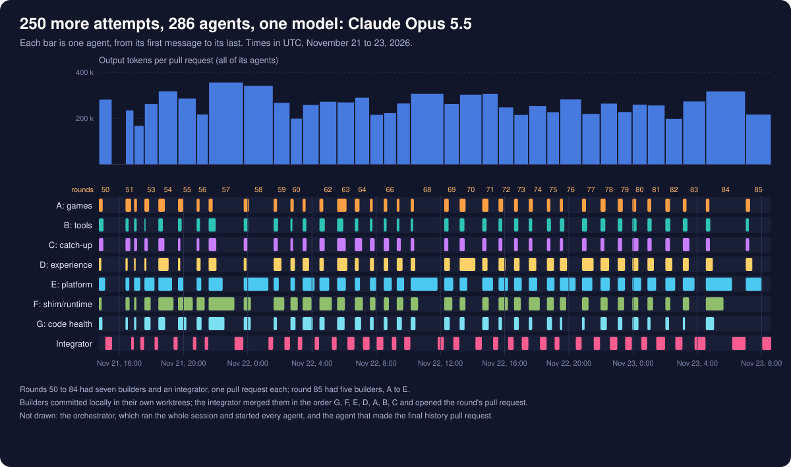

# How this project got here

This repo holds 20 small Java programs written more than ten years ago, recovered from what was left of them, fixed up, and then reworked into a browser arcade. This page tells that story in order. The per-app READMEs, [`web/README.md`](web/README.md) and the [pull requests](https://github.com/Nate314/old-java-applications/pulls?q=is%3Apr) have the details.

The source of inspiration for this project is the YouTube video [I Told Claude to "Make it better" 100 Times (It Went Too Far)](https://www.youtube.com/watch?v=DByAR5Su1Yw) by Nate Herk | AI Automation.

## The originals (2016 and earlier)

The apps were written by the author of this repo more than ten years ago, in high school, while the author was learning programming concepts with Java. They are Java Swing and AWT desktop programs: games (Minesweeper, Flappy Bird, Ultimate Tic-Tac-Toe, a tank game, a 2D Rubik's Cube), toys (a screen saver, floating stars, circles built out of windows, a fake desktop called NathaNOS), music tools (a synthesizer keyboard, a music theory helper) and small utilities (a clock, a stock checker, a group maker, a Bible downloader, a number guessing game, a set of algorithms, and two programs that press keys on Windows).

Fourteen of them were published as jars and zips on the author's site, https://nathangawith.com/applications/java, and are kept in the git history of its repo, https://github.com/Nate314/site, under `assets/javaApplications/`. Dated evidence that survives:

- The files inside those 14 jars and zips carry timestamps from April 28 to May 16, 2016 (ScreenSaver's are the oldest, the rest are from May 14 to 16, 2016).
- `StockChecker/stockCheck.csv`, saved by StockChecker itself, holds quotes dated May 13, 2016.

The other six apps (BibleDownloader, GroupCreator, MusicTheoryExpert, NumberGuess, SimpleAlgorithms, TankGame) came from the author's own files. No dates for those are recorded in this repo.

## The recovery (October 2026)

The source code was gone for most of the apps, so it was rebuilt from the compiled programs:

- **The first eight** (Clock, FlappyBird, Minesweeper, NathaNOS, RubiksCube2D, ScreenSaver, SpriteFloatyStars, UltimateTicTacToe) were downloaded from https://nathangawith.com/applications/java and decompiled with Vineflower 1.10.1 (the repo's first commit).
- **Six more** (CircleSpawner, DinoGame, StockChecker, SynthesizerKeyboard, Windows, WindowsE) were no longer on the site. They were found in the git history of the site repo and decompiled the same way ([#2](https://github.com/Nate314/old-java-applications/pull/2)).
- **The last six** came from the author's own files ([#8](https://github.com/Nate314/old-java-applications/pull/8)). MusicTheoryExpert, NumberGuess, SimpleAlgorithms and TankGame were the original Eclipse source; BibleDownloader and GroupCreator were jars, decompiled with Vineflower.

Most of the jars had been obfuscated, so classes were called `a`, `b`, `c` and locals `var1`, `var2`. Every one of those names was replaced with a descriptive English name, without changing any logic ([#1](https://github.com/Nate314/old-java-applications/pull/1), [#3](https://github.com/Nate314/old-java-applications/pull/3)). A few files needed hand fixes to compile again, listed in the root [README](README.md#notes).

## The first restoration

The next pull requests were each asked for directly, one at a time:

- **[#4](https://github.com/Nate314/old-java-applications/pull/4)** wrote a README for every app (what it does, its controls, its code layout and its known quirks) and `run.ps1`, which builds and runs any app from the repo root.
- **[#6](https://github.com/Nate314/old-java-applications/pull/6)** modernized all 20 apps: it fixed the bugs each README listed (Minesweeper's mine count and flood fill, Ultimate Tic-Tac-Toe's winner check, SimpleAlgorithms' sine, NumberGuess's range, and many more), moved timing work off the Swing event thread and added a few small features per app, keeping each app recognizably itself.
- **[#7](https://github.com/Nate314/old-java-applications/pull/7)** compiled 16 of the 20 apps to JavaScript with TeaVM, on a hand-written AWT/Swing/MIDI compatibility layer, so they run in a browser. DinoGame, Windows and WindowsE drove the real operating system and BibleDownloader read pages a browser could not fetch, so those four stayed desktop only.
- **[#9](https://github.com/Nate314/old-java-applications/pull/9)** replaced real people's names in GroupCreator's example with generic ones, made Modern the default web skin, and put every app on NathaNOS's taskbar.

That state, commit `5a28e46` on master, is what the site's **Then** versions play today (see [Then and now](web/README.md#then-and-now)): the recovered code with light bug fixes, before the reworks below.

## The Claude Code chain (from #10)

From [#10](https://github.com/Nate314/old-java-applications/pull/10) on, the pull requests were made by a chain of Claude Code subagents. Each one got the same task, to look at the project and make one bold change that improves the experience, and each pull request is stacked on the one before. At first the attempts ran one at a time; from [#79](https://github.com/Nate314/old-java-applications/pull/79) they ran in parallel rounds of three (a game or toy app, a tool or music app, and the site itself), merged and checked by an integrator into one pull request per round. [`prompt.md`](prompt.md) has the exact prompt and the rules the chain learned along the way.

Roughly, the work went through three phases:

1. **The site around the apps** (#10 to #21): a home page with a live player and thumbnail gallery, an arcade passport, a touch controller, the Arcade skin, an installable offline app, sounds, title screens, a source viewer, share cards and a real desktop for NathaNOS.
2. **The apps themselves** (#22 to #43): every app got a deeper pass of its own, for example Minesweeper levels and best times (#22), a computer opponent for Ultimate Tic-Tac-Toe (#23), a finished tank duel (#24), StockChecker as a practice trading desk (#39) and BibleDownloader as a Bible reader (#40). By #42 all 20 apps ran in the browser, including the ones that press keys, on a pretend Windows.
3. **Across apps and the whole site** (#44 on): the Then and now switch (#44), game controllers (#47), keyboard and screen reader support (#48), instant replay (#55), the computer playing the games (#58), a site screen saver (#64), live previews in the gallery (#70) and site-wide Find (#80), alongside further app work such as RubiksCube2D in 3D with a coach (#59, #78) and SimpleAlgorithms' sorting race and path finding (#65, #80).

The [pull request list](https://github.com/Nate314/old-java-applications/pulls?q=is%3Apr) has every change, each with what it did and how it was tested, and the home page's What's new section lists the changes app by app.

## The run in numbers

The 100 attempts are pull requests #10 to #78 (attempts 1 to 69, one at a time) and #79 to #90 (attempts 70 to 100, in eleven parallel rounds), with the one-off #83 between rounds 4 and 5. A final pull request on top of #90 adds this section, the jar downloads and the original art below, and carries all of it to master.

- **Model**: every agent, and the orchestrator session that started them and read their reports, ran on Claude Opus 5.5 (model id `claude-opus-5-5`) in Claude Code.
- **Agents**: 124 finished agents, all of whose usage was found: 69 one-at-a-time attempts, 31 round builders, 11 round integrators, the one-off #83, and 12 agents on October 31 that helped with #1 to #8 before the chain. The agent making this final pull request is not counted (it was still running when the numbers were read).
- **Tokens of the 124 agents**, summed over every model response in their transcripts: 7,769,877 output tokens; 21,752 input tokens not served from the prompt cache; 32,985,276 tokens written to the prompt cache; 1,510,951,972 tokens read from the prompt cache. That is 1,551,728,877 in all, almost all of it the same context read again from the cache on each turn. The 111 agents of the 100 attempts alone account for 6,978,117 output tokens and 1,353,738,248 in all.
- **The orchestrator's own tokens**, counted the same way from its session (October 31 to November 3, up to the start of the final pull request), are not in the numbers above: 522,249 output tokens; 1,684 uncached input tokens; 1,838,268 written to and 179,600,754 read from the prompt cache; 181,962,955 in all. With them the whole session comes to 8,292,126 output tokens and 1,733,691,832 tokens in all.
- **Tool calls**: 15,299 by the 124 agents, as reported when each finished.
- **Time**: the chain ran from November 1, 2026 at 18:39 UTC to November 3 at 06:42 UTC, about 36 hours, including a pause of about 7.7 hours when attempt 35's agent stalled and was resumed. The agents' own working time adds up to about 42 hours, about 8 of which is that stalled agent's wait.

These are the usage numbers Claude Code recorded for the session, not a bill: cache reads cost far less than fresh input, and the completion notices' own per-agent token figure (which counts differently) is not used here.

## The continued run (#97 to #134)

After [#91](https://github.com/Nate314/old-java-applications/pull/91) carried the chain to master, [#92](https://github.com/Nate314/old-java-applications/pull/92) moved the site to React and TypeScript, [#93](https://github.com/Nate314/old-java-applications/pull/93) and [#95](https://github.com/Nate314/old-java-applications/pull/95) added Docker and `run.sh`, and [#96](https://github.com/Nate314/old-java-applications/pull/96) wrote the "Continuing the chain" section of [`prompt.md`](prompt.md), the chain was asked on November 14, 2026 (local time) for 150 more attempts, numbered 101 to 250. They ran in 38 rounds, rounds 12 to 49, with one pull request per round: [#97](https://github.com/Nate314/old-java-applications/pull/97) (round 12, based on master) to [#134](https://github.com/Nate314/old-java-applications/pull/134) (round 49), each based on the round before. A round had four builders at once, each committing to a local branch in its own worktree, and an integrator that merged the four branches in the main checkout, ran the type check, the self-checks and the full build, checked every feature in Chrome and opened the round's pull request. The last round had two builders, for attempts 249 and 250. The run paused after round 12 for review, then went on unattended.

Each round's builders had a lane:

- **Lane A**: one game or toy app.
- **Lane B**: one tool or music app.
- **Lane C**: the site itself, its runtime and the AWT/Swing shim, never an app's sources.
- **Lane D**: the app with the fewest attempts so far. From round 14 on, at the user's request, Lane D in every even round was instead a behavior-preserving refactor of the web app's own code, merged first so the round's features were fitted onto the cleaned code.

The shared brief gained rules along the way, several after something went wrong: no test may write the system clipboard (round 28 overwrote it from a desktop test), every app's sound is muted in tests (round 39 played a song aloud), `rm -rf` is never run on a relative or computed path (two builders' commands nearly deleted folders outside the scratch folder), each builder serves its own worktree's build (two served the main checkout's), headless Chrome profiles stay in the scratch folder (round 46 left one in `%TEMP%`), no screen is modeled on a commercial game or product, and commit subjects are written for visitors, since the site shows them in What's new, with refactors starting `Refactor:` and docs-only changes `Docs:` or `README:` so What's new folds them into Behind the scenes.

Roughly, the work fell into four groups:

1. **The apps, deeper** (Lanes A, B and D): for example the on-screen Windows key (#97), ScreenSaver's Maze saver (#98), a guitar neck in MusicTheoryExpert's chord finder (#100), exact mine odds in Minesweeper (#102, counted on every board from #130), My cube for RubiksCube2D (#104), Westminster chimes and an alarm hand for the Clock (#104, #108), TankGame's battlefield builder (#110), sheet music in MusicTheoryExpert (#124) and Ultimate Tic-Tac-Toe showing where each move sends you (#134).
2. **The site** (Lane C): a head script cut from about 200 KB to about 7 KB (#97), Slow-mo (#101), high contrast (#103), WebP thumbnails that took a phone's home page load from about 11.5 to about 4.5 seconds (#112), passport stamps (#118), an exit screen recap (#119), Then and Now side by side (#120), What's new as release notes (#123), calmer app pages (#127) and Try again when an app fails to download (#130).
3. **The shim** (Lane C): saves merged per file across open pages (#107), a reduced-motion setting the apps can read (#108), adopted by TankGame, Clock, FlappyBird, DinoGame and ScreenSaver, and memory fixes that free closed windows and removed layers (#131, #133), with NathaNOS windows kept under its taskbar (#134).
4. **Refactors** (Lane D, the 18 even rounds from 14 to 48): one script loader (#99), one `fetchOk` (#101), one storage helper (#105), one `openPanel` for six panels (#109), and the home page's tour, Take it with you and Passport tabs moved into their own files (#119, #127, #131), each checked to leave the built site working as before.

### The continued run in numbers

A final pull request on top of #134 adds this section and the story page's chapter for it.

- **Model**: every agent, and the orchestrator session that started them and read their reports, ran on Claude Opus 5.5 (model id `claude-opus-5-5`) in Claude Code.
- **Agents**: 188 finished agents: 150 builders (attempts 101 to 250) and 38 round integrators (rounds 12 to 49). The agent making this final pull request is not counted.
- **Tokens of the 188 agents**, summed once per model response in their transcripts: 6,578,546 output tokens; 24,966 input tokens not served from the prompt cache; 37,969,154 tokens written to the prompt cache; 1,291,612,928 tokens read from the prompt cache. That is 1,336,185,594 in all.
- **The orchestrator's own tokens**, counted the same way from its session (from the request at 04:48 UTC on November 15 to 03:05 UTC on November 16, before the final pull request), are not in the numbers above: 366,007 output tokens; 1,232 uncached input tokens; 1,018,242 written to and 193,275,331 read from the prompt cache; 194,660,812 in all. With them the whole run comes to 6,944,553 output tokens and 1,530,846,406 tokens in all.
- **Tool calls**: 16,016 by the 188 agents and 297 by the orchestrator, counted from the transcripts.
- **Time**: the run went from the first builder's start on November 15, 2026 at 04:53 UTC to the last integrator's finish on November 16 at 03:04 UTC, about 22 hours. The time with no agent running, the orchestrator's bookkeeping between rounds, adds up to 59 minutes, with no gap over 10 minutes. The agents' own working time adds up to about 43 hours.

As for the first run, these are the usage numbers Claude Code recorded, not a bill.

## The third run (#138 to #173)

On November 21, 2026 (local time) the chain was asked for 250 more attempts, numbered 251 to 500. They ran in 36 rounds, rounds 50 to 85, with one pull request per round: [#138](https://github.com/Nate314/old-java-applications/pull/138) (round 50, based on master) to [#173](https://github.com/Nate314/old-java-applications/pull/173) (round 85), each based on the round before. A round had seven builders at once (five in round 85, lanes A to E), each committing to a local branch `link<N>` in its own worktree, and an integrator that merged the branches in the main checkout in the order G, F, E, D, A, B, C, ran `npm ci` and the type check, the apps' self-checks, the full build, the smoke test, the offline test and phone vitals, checked every change in Chrome at about 400 px and 900x600 in all three skins, and opened the round's pull request. The run paused after round 50 for review (the 50 minute gap before attempt 258 started), then went on unattended.

Each round's builders had a lane:

- **Lane A, games and toys**: one game or toy app.
- **Lane B, tools and music**: one tool or music app, or the desktop Launcher.
- **Lane C, catch-up**: the app with the fewest attempts overall, other than A's and B's, which may also bring its Then page or desktop jar up to date.
- **Lane D, experience**: the pages visitors land on, the shared page code and the app page's title screen.
- **Lane E, platform**: performance and modern web platform features, build and serving, every change with before and after numbers.
- **Lane F, shim and runtime**: root causes fixed in the AWT/Swing shim and the runtime, never in an app.
- **Lane G, code health**: one behavior-preserving refactor or one test or tooling improvement, merged first, with an entry in the brief's refactor log.

The shared brief gained rules along the way, after something went wrong: use only your own ports (round 54's lane F used ports outside every range and two of its probes collided), and put a second server on your own second port (round 78's lane F served a before build on lane G's port and broke G's smoke run); install the sound stubs before any app can start (round 57's lane B played a few notes through the speakers because it stubbed sound after pressing Play), turn a desktop app's sound off before anything can play (round 64's SimpleAlgorithms builder ran the Sorting race with sound on in a headless render), and wrap `AudioContext` so every new context starts suspended (round 79's lane C stubbed only `resume`, and the site's own Play sound may have sounded once); stop only processes you started, by the PID you recorded (round 76's lane E piped netstat into taskkill and it targeted PID 4, System, which Windows refused); work only in a Chrome tab you created (round 68: one agent's script may have hit another lane's harness); never run `mvn install` (round 58 left a shim jar in `~/.m2`); never run `rm -rf` on a relative path, even for build output (round 50's lane A did, inside its worktree); and builders edit only their own worktree (round 83's lane G left a partial uncommitted edit in the main checkout).

Roughly, the work fell into five groups:

1. **The apps, deeper** (Lanes A, B and C): for example RubiksCube2D's dragged layer following the pointer and DinoGame's crash coach (#138), Minesweeper's first game teaching flagging and chording (#142), ScreenSaver waking to the wall of all ten savers (#147), an LED face and then real-looking dials for the Clock (#152, #173), TankGame's four grounds (#153), StockChecker's live desk (#154) and BibleDownloader as an open book with depth (#171).
2. **The site** (Lane D): the phone home gallery as a two-column tile grid (#138, the page at 400 px from 11,374 to 4,285 px tall), play.html with no app as a tile picker (#141) and then a channel guide (#167), the story page playing each app in a sheet over the page (#151), a search field in the home gallery (#161), What's new leading with a reel of the latest-changed apps (#168), Records as a trophy shelf (#170), a picture of your own passport to share (#172) and Then pages carrying a postcard of today's version (#173).
3. **The platform** (Lane E): content-hashed asset names so a new build never mixes with a cached old one (#138), gzip (#139), the home title and lead prerendered (#141, throttled phone LCP from about 3.0 to about 1.3 seconds), Back restoring an app from the back/forward cache (#149, Back from 308-340 to 9-27 ms), parallel Maven modules (#153, a clean build from 178 to about 115 seconds) and split compiles (#154, from about 160 to about 50-66 seconds), the home phone poster painted from the HTML (#165, LCP 2868 to 956 ms) and packed CSS (#166, home FCP 964 to 824 ms).
4. **The shim and runtime** (Lane F): unfocusable windows keeping off the keyboard (#139), `JTextField` documents (#140), instant replay no longer leaking a media stream (#142), many more Java 2D shapes and transforms (#146, #153, #159, #163), names for every field and key (#150, #156, axe critical issues 13 to 0), held keys released on a browser blur (#166), a hidden page holding its moving apps (#168) and every app quiet when hidden (#171).
5. **Code health and tests** (Lane G): `web/smoke.ps1` (#138, the home page and 21 apps) grown to 110 pages (#172), `web/checks.ps1` for the apps' self-checks (#139), `web/offline.mjs` (#145), `web/sitediff.mjs` (#147), `web/wiring.mjs` (#155), `web/vitals.mjs` (#162), and refactors such as the stage layout and the exit screen moved into their own files (#144, #148) and per-part compiles (#173, a clean build from 87 to 80 seconds).

### The third run in numbers

A final pull request on top of #173 adds this section and the story page's chapter for it.

- **Model**: every agent, and the orchestrator session that started them and read their reports, ran on Claude Opus 5.5 (model id `claude-opus-5-5`) in Claude Code.
- **Agents**: 286 finished agents: 250 builders (attempts 251 to 500) and 36 round integrators (rounds 50 to 85). The agent making this final pull request is not counted.
- **Tokens of the 286 agents**, summed once per model response in their transcripts: 9,358,398 output tokens; 36,602 input tokens not served from the prompt cache; 61,811,829 tokens written to the prompt cache; 2,026,076,348 tokens read from the prompt cache. That is 2,097,283,177 in all.
- **The orchestrator's own tokens**, counted the same way from its session (from the request at 14:37 UTC on November 21 to 08:36 UTC on November 23, before the final pull request), are not in the numbers above: 539,189 output tokens; 2,138 uncached input tokens; 2,067,958 written to and 291,950,015 read from the prompt cache; 294,559,300 in all. With them the whole run comes to 9,897,587 output tokens and 2,391,842,477 tokens in all.
- **Tool calls**: 21,403 by the 286 agents and 618 by the orchestrator, counted from the transcripts.
- **Time**: the run went from the first builder's start on November 21, 2026 at 14:43 UTC to the last integrator's finish on November 23 at 08:36 UTC, about 42 hours. The time with no agent running adds up to 113 minutes, with one gap over 10 minutes: the 50 minute pause for review before attempt 258. The agents' own working time adds up to about 108 hours.

As for the first two runs, these are the usage numbers Claude Code recorded, not a bill.

## Original art

Some of the pictures the apps loaded were not their own. FlappyBird's bird, pipes, sky and ground were the original Flappy Bird game's art, and BibleDownloader's icon was the YouVersion Bible App's icon. NathaNOS's desktop icons included Chrome's dinosaur (for DinoGame), a Windows Minesweeper mine and an unused Windows logo; its mouse pointer was a pointing hand from an icon set; and its other icons (Clock, NumberGuess, StockChecker, SynthesizerKeyboard, UltimateTicTacToe, plus unused calculator, converter and ping pong pictures) were clip art of unknown origin. Dino Game's pixel dinosaur and bird, drawn in its code, were modeled closely on Chrome's.

The final pull request replaced them with original art drawn for this repo: SVG files in each app's `art/` folder, rendered by `web/art.ps1` with headless Chrome to the PNG and JPEG files the Java code reads (same names, so the code did not change), and a new pixel dinosaur and bird in Dino Game's code. The unused pictures were removed. The Then versions, on the site and in the desktop launcher, show the new art too. Kept as they were, since nothing ties them to another app: NathaNOS's own logos, its wallpaper photo (where it came from is not recorded) and RubiksCube2D's plain cube net. The old files are still in the repo's git history, which was not rewritten.
